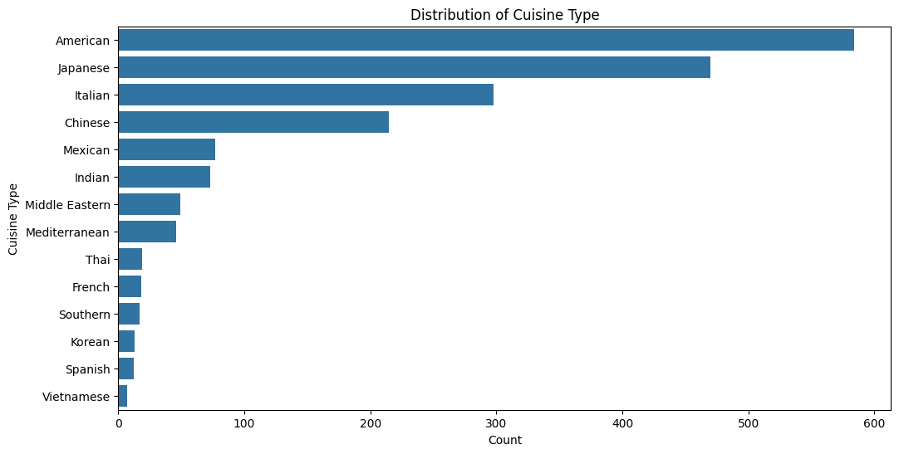
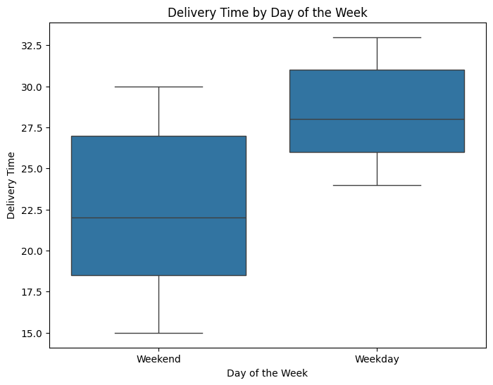
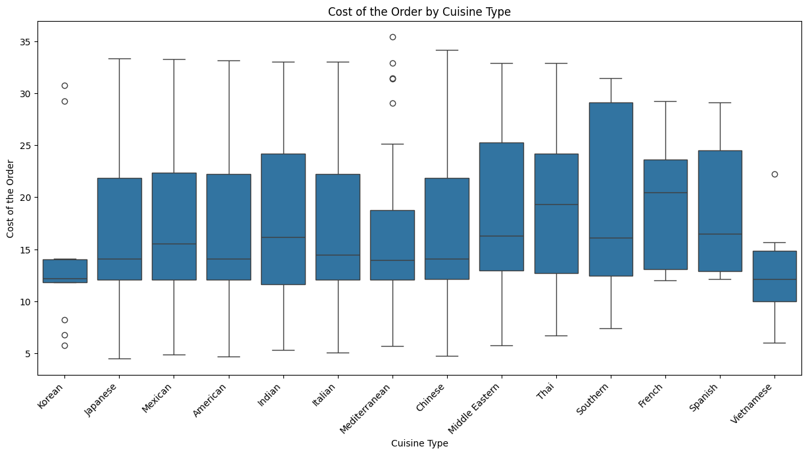

# FoodHub Order Analysis

Exploratory data analysis project for the **MIT Applied AI & Data Science Program** (Foundations for Data Science). It analyses 1,898 orders from FoodHub, a New York food-delivery aggregator, to understand restaurant demand and delivery performance and to make business recommendations.

---

## Business problem

FoodHub connects customers with restaurants through one app and earns a commission on each order. The company wants to understand which restaurants and cuisines drive demand, how long orders take to reach customers, and where the customer experience can improve.

## Dataset

`data/foodhub_order.csv` has 1,898 orders and 9 columns:

| Column | Description |
| --- | --- |
| `order_id`, `customer_id` | Order and customer identifiers |
| `restaurant_name`, `cuisine_type` | Where the food came from (178 restaurants, 14 cuisines) |
| `cost_of_the_order` | Order value in USD |
| `day_of_the_week` | Weekday (Mon–Fri) or Weekend (Sat–Sun) |
| `rating` | 3–5, or "Not given" |
| `food_preparation_time` | Minutes from restaurant confirmation to pickup |
| `delivery_time` | Minutes from pickup to drop-off |

## Key findings

| Question | Answer |
| --- | --- |
| Unrated orders | **736 (38.8%)** |
| Top 5 restaurants | Shake Shack (219), The Meatball Shop (132), Blue Ribbon Sushi (119), Blue Ribbon Fried Chicken (96), Parm (68) |
| Most popular cuisine (and on weekends) | American |
| Orders over $20 | **29.24%** |
| Mean delivery time | **24.16 min**: weekday 28.34, weekend 22.47 |
| Orders taking > 60 min end to end | **10.54%** |
| Net commission revenue | **$6,166.30** (25% on orders > $20, 15% on orders > $5) |
| Restaurants qualifying for promotion (> 50 ratings, avg > 4) | The Meatball Shop (4.51), Blue Ribbon Fried Chicken (4.33), Shake Shack (4.28), Blue Ribbon Sushi (4.22) |

<p align="center">
  
  
</p>

### Insights

- **Demand is concentrated.** American, Japanese, Italian and Chinese make up about 83% of orders, and 71% of orders come on weekends.
- **Order value varies by cuisine.** French and Thai have the highest median order cost (about $19–20), while Korean and Vietnamese are the lowest (about $12).
- **Weekday deliveries are slower.** They take about 6 minutes (26%) longer on average than weekend deliveries, while weekend times vary more.
- **Operational variables are independent.** Cost, preparation time, delivery time and rating have near-zero correlations with each other.

<p align="center">
  
</p>

### Recommendations

1. **Fix weekday delivery times.** Add delivery-partner capacity and improve routing at weekday peaks, and use demand-based scheduling on weekends. Track the share of orders taking more than 60 minutes as a KPI.
2. **Use cuisine insights for revenue.** Promote higher-value cuisines (French, Thai), and protect the high-volume cuisines and top restaurants with service levels and loyalty offers.
3. **Grow feedback coverage.** Use small incentives or one-tap prompts to cut the 38.8% unrated rate, so quality monitoring is reliable.

## Repository structure

```
.
├── notebooks/
│   └── FoodHub_Data_Analysis.ipynb   # full, commented notebook with outputs
├── data/
│   └── foodhub_order.csv
├── reports/
│   └── FoodHub_Data_Analysis.html    # HTML export of the submitted notebook
├── images/                           # figures used in this README
├── requirements.txt
└── README.md
```

## How to run

```bash
python -m venv .venv && source .venv/bin/activate
pip install -r requirements.txt
jupyter notebook notebooks/FoodHub_Data_Analysis.ipynb
```

The notebook reads `data/foodhub_order.csv` and runs top to bottom in a few seconds.

## Tech stack

Python · pandas · NumPy · Matplotlib · Seaborn · Jupyter

---

*Sauraj Karki, MIT Applied AI & Data Science Program*
